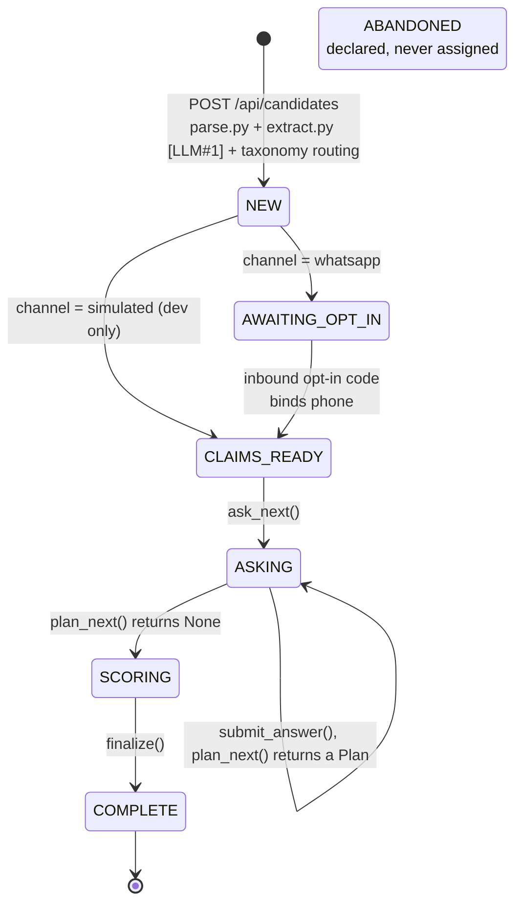
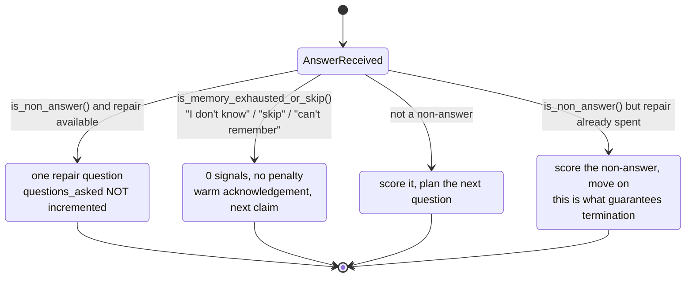
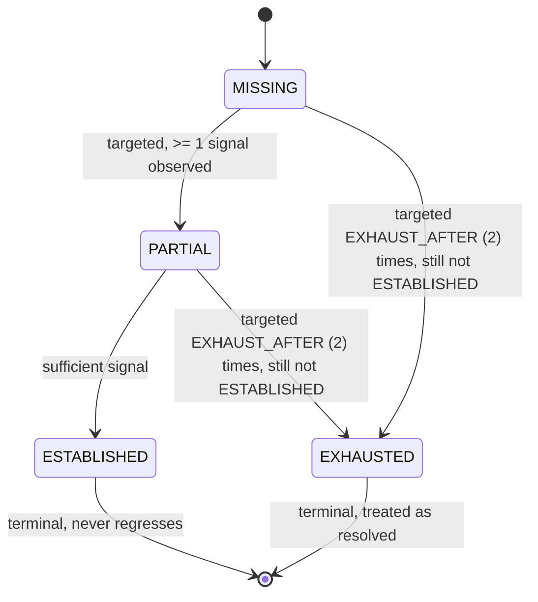
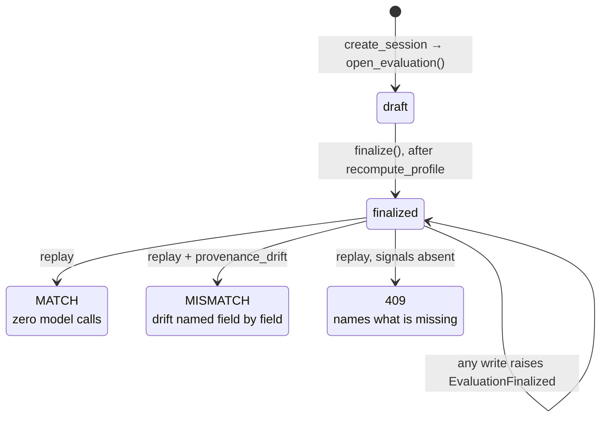
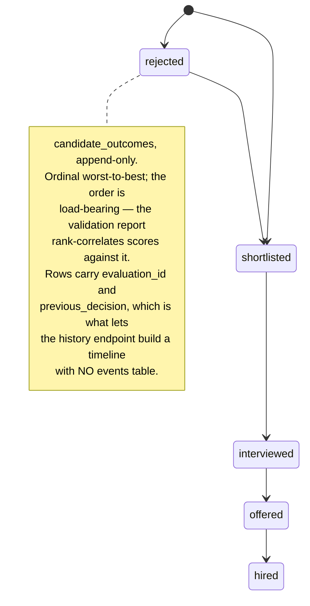

# ProofScreen — state machines

**Derived from code, not from a plan.** Every box, edge and constant below was
read out of `api/` at `2659f20`. Where this file and the code disagree, the code
is right and this file is stale — regenerate it rather than patching it.

This document deliberately **does not restate** any frozen decision
(`docs/EXECUTION_STANDARD.md` C3). It draws the shapes and cites where each one
is enforced. The reasons behind the shapes live in `CLAUDE.md`,
`docs/ARCHITECTURE_LOCK_v1.md` and `docs/PHASE_2_EXECUTION_PLAN.md`.

There are **four** machines, nested rather than sequential:

| # | Machine | Scope | Enum / owner |
|---|---|---|---|
| 1 | [Session lifecycle](#1-session-lifecycle) | one interview | `SessionState` — `api/schemas.py:93` |
| 2 | [Question turn](#2-the-question-turn) | one question | no enum; `questions.source` records the exit |
| 3 | [Evidence coverage](#3-evidence-coverage-per-claim-per-category) | one claim × one category | `CoverageState` — `api/engine/v2_evidence_planner.py:36` |
| 4 | [Evaluation lifecycle](#4-evaluation-lifecycle) | one assessment record | `EvaluationStatus` — `api/schemas.py:671` |

Machine 3 is **off by default** (`EVIDENCE_PLANNER_V2=false`). Machine 1 is
always on; machine 2 runs once per turn of machine 1; machine 4 is opened by
machine 1 and outlives it.

---

## 1. Session lifecycle

`SessionState`, seven members, **six reachable**.



### Transitions, with the line that writes them

| From | To | Written at | Trigger |
|---|---|---|---|
| — | `NEW` | `orchestrator.py:1087` | `create_session` inserts the row |
| `NEW` | `AWAITING_OPT_IN` | `orchestrator.py:1110` | `channel is Channel.whatsapp` |
| `NEW` | `CLAIMS_READY` | `orchestrator.py:1110` | any other channel |
| `AWAITING_OPT_IN` | `CLAIMS_READY` | `routers/whatsapp.py:318`, `:413` | opt-in code matched, phone bound |
| — | `CLAIMS_READY` | `routers/dev.py:204` | `/api/dev/*` shortcut |
| `CLAIMS_READY` | `ASKING` | `orchestrator.py:1424` | `ask_next` emits the first question |
| `ASKING` | `SCORING` | `orchestrator.py:1912` | `finalize()` entered |
| `SCORING` | `COMPLETE` | `orchestrator.py:1918` | scoring done, `completed_at` set |

Two things happen on the way in and out that are not state writes but belong on
the diagram:

- **Entering `NEW`**, `create_session` also calls
  `evaluation_engine.open_evaluation` — the draft of machine 4 opens *with* the
  interview, not after it.
- **Leaving `SCORING`**, `finalize()` calls `graph.recompute_profile` **before**
  finalizing the evaluation, because the evaluation reads the profile.

### `AWAITING_OPT_IN` is a platform constraint, not a design choice

WhatsApp Business Cloud API will not let us free-form message a candidate who
has not messaged us first, and the 24-hour window only opens on their message.
The state exists to hold the interview until that happens. `channel=simulated`
skips it and is reachable from `/api/dev/*` only — never from a real candidate.

### `ABANDONED` is unreachable and that is deliberate

Declared at `api/schemas.py:100`. **Three reads, zero writes.** Nothing assigns
it. `EvaluationStatus` therefore has no `abandoned` member either — an abandoned
evaluation would be an unreachable state with an untestable transition.

### Termination

`ASKING` cannot loop forever. Three independent bounds:

1. `plan_next` returns `None` when `index >= settings.max_questions`
   (**default 6**, `api/config.py:38`).
2. A claim closes on saturation — `score >= SATURATION_AT` (**80**,
   `engine/scoring.py:49`) — and a session with every claim closed has nothing
   to plan.
3. A second consecutive non-answer is accepted rather than repaired
   (`_maybe_repair`, below), so a disengaged candidate still terminates.

---

## 2. The question turn

No enum backs this one. The exit is recorded on the `questions` row as
`source` ∈ `model | fallback | repair`, alongside `attempts`,
`violations_json` and `is_repair` — which is what makes M6 computable from
stored rows rather than from logs.

```
   ┌───────────────────────────────────────────────────────────────┐
   │ plan_next(states, index)          PURE PYTHON — no LLM, no RNG │
   │ ───────────────────────────────────────────────────────────── │
   │  index >= MAX_QUESTIONS ───────────────────────► None → SCORING│
   │  ADAPTIVE_PROBING=false → strict LADDER_ORDER sweep            │
   │  0 < answers < MIN_STREAK (=2) → stay on the active claim,     │
   │                                  aim at its weakest dimension  │
   │  claims with no levels_used → breadth first, heaviest first    │
   │  saturated (score >= 80) → close, UNLESS PERTURB still pending │
   │                            (TRANSFER_PROBE=true only)          │
   └───────────────────────────┬───────────────────────────────────┘
                               │ Plan(claim, probe_level,
                               │      target_dimension, reason, transfer?)
                               ▼
                   ┌───────────────────────────┐
                   │  attempt 1  [LLM#2]       │  question.py:976
                   │  WORDING ONLY             │  source=model
                   └─────────────┬─────────────┘
                                 ▼
              ┌──────────────────────────────────────┐
              │ validate()   SEVEN RULES, PURE PYTHON│
              │   answer_leakage                     │
              │   duplicate_content                  │
              │   multiple_fact_targets  ◄─ skipped on TRANSFER: a valid
              │   hypothetical_misuse               T1 probe pairs one claim's
              │   unsupported_metric                method with another's
              │   scope_drift                       problem, so two fact
              │   no_claim_anchor                   targets IS the mechanism
              └────────┬────────────────┬────────────┘
                     clean          violations
                       │                │
                       │                ▼
                       │    ┌───────────────────────────┐
                       │    │  attempt 2  [LLM#2]       │  ONE regeneration.
                       │    │  regenerate               │  Two explicit calls,
                       │    └─────────────┬─────────────┘  NEVER a loop — a
                       │                  ▼                 loop invites raising
                       │            validate() again        the constant, and
                       │             │           │          the ceiling is the
                       │           clean      still bad     +20% median-latency
                       │             │           │          guardrail.
                       │             │           ▼
                       │             │   ┌────────────────────┐
                       │             │   │ FALLBACK           │ question.py:1003
                       │             │   │ On "<claim>" — …   │ source=fallback
                       │             │   └─────────┬──────────┘
                       ▼             ▼             │
                  ┌──────────────────────────────────────┐
                  │  SEND — questions row records         │
                  │  source · attempts · violations_json  │
                  │  · is_repair                          │
                  └─────────────────┬────────────────────┘
                                    ▼
                    ┌───────────────────────────────┐
                    │  responses   ◄── THE SEAM      │  text, or voice
                    └───────────────┬───────────────┘     via Whisper
                                    ▼
             ┌──────────────────────────────────────────────┐
             │ _persist_evidence → engine/evidence [LLM#3]  │
             │   returns COUNTABLE SIGNALS + facts          │
             │   enforce_verbatim() drops any quote not     │
             │     literally present in the answer          │
             │   consistency.py runs over the fact memory   │
             └──────────────────────┬───────────────────────┘
                                    ▼
                signals.py → scoring.py → graph.py
                counts ──► six dimensions ──► weighted, live re-rankable
```

### The fallback is never validated, and cannot be

It is rendered `On "<claim>" — <base>`, so it quotes the claim **including its
figures** and trips `answer_leakage` by construction. `CLAUDE.md` rule 5
requires every LLM call to have a fallback; a validator able to reject the
fallback would leave no path at all. This is load-bearing, not an oversight.

### Repair sub-machine — off-budget, deterministic, no model call

`_maybe_repair`, `orchestrator.py:1827`. Gated on `REPAIR_TURN=true`.



The repair turn does **not** re-plan, does not change the probe level and does
not touch `questions_asked` — the whole point is that the turn is free. The
answer that follows is stored and scored like any other; only the *budget* and
the *stall count* treat it differently.

**Measured, Phase 3: it fired zero times in 68 real interviews.**
`is_non_answer()` wants a canned phrase or fewer than 12 characters, and no
realistic candidate writes either. That is reported as a failure in
`docs/PHASE_3_VALIDATION_STUDY.md`, not fixed — a persona authored to reply
"ok" would be fitting the data to the test.

### Probe order

`PROBE_ORDER`, `engine/signals.py:71`. `LADDER_ORDER` is an alias for it.

```
OPERATIONAL → INCIDENT → DECISION → OUTCOME → TRANSFER → VALIDATION
```

Execution-first: the interview opens on how the work actually ran, not on
validating that it happened. A level is only selectable once it appears in this
tuple, which is how `TRANSFER` could be declared long before it was activated.

---

## 3. Evidence coverage, per claim × per category

`EVIDENCE_PLANNER_V2=false` by default (`api/config.py:105`). When on, each of
the ten `EvidenceCategory` values runs this machine independently on each claim.



`EXHAUSTED` is excluded from the unlocked level **the same way `ESTABLISHED`
is**. A category the candidate cannot evidence would otherwise drag the level
down forever.

Acquisition order is `PRIORITY_ORDER` — highest invention-cost first, a property
of the category rather than of the claim's archetype:

```
INCIDENT → CROSS_CLAIM_LINK → DECISION → CAUSAL_CHAIN → METRIC_DEFINITION
→ CONSTRAINT → …
```

**This machine is turn-order dependent.** `MISSING → PARTIAL → ESTABLISHED` and
the `EXHAUST_AFTER` counter both depend on the sequence, which is why
`ClaimState.targeted_sequence` is an ordered list replayed turn by turn, unlike
`moves_used` which only needs a flat set.

---

## 4. Evaluation lifecycle

`EvaluationStatus`, `api/schemas.py:671`. **Two states, and both are observed
rather than invented.**



- There is **no `running`**. The live state is `sessions.state` — machine 1 —
  and duplicating it here would recreate the `profiles.status` confusion that
  Phase 4 exists to end.
- There is **no `abandoned`**, for the reason given under machine 1.
- **One evaluation per session**, by UNIQUE constraint.
- **Immutability is enforced at the ORM layer**, not in the service function: a
  `before_update` listener raises `EvaluationFinalized` on any write to a row
  whose `finalized_at` was already set. A new assessment is a new interview and
  a new row.
- **Replay recomputes from stored signals with zero model calls.** The contract
  in full: *extraction is recorded; everything downstream of extraction is
  replayable.* `resume_score` is excluded — it is a function of live
  configuration, not of stored evidence. A 409 **names what is absent**, because
  scoring what remains would be a confident lower number produced by missing
  data.

### The decision trail hanging off `finalized`



Any transition is permitted; the ordering exists for rank correlation, not for
validation. There is deliberately **no events table** — its content would
duplicate two columns on `evaluations` plus the already-append-only
`candidate_outcomes`.

---

## The invariant all four machines exist to enforce

Read the diagrams by *who decides*, not by box:

| Stage | Decided by | Enforced at |
|---|---|---|
| What to ask | **Python** | `orchestrator.plan_next()` — pure, deterministic |
| How to word it | LLM #2 | `engine/question.py` |
| Whether the wording is acceptable | **Python** | `question.validate()` — 7 rules |
| What the answer contains | LLM #3 | `engine/evidence.py` |
| Whether a quote is real | **Python** | `evidence.enforce_verbatim()` |
| What any of it is worth | **Python** | `signals.py` → `scoring.py` |

Every LLM box is bracketed by a Python box on both sides, and every LLM box has
a fallback (`extract.heuristic_claims`, `question.FALLBACK_QUESTIONS`,
`evidence.heuristic_signals`) that is production code rather than a stub. Two
tests enforce the split structurally:
`test_scoring_modules_never_import_the_llm` and
`test_answer_signals_carries_no_score_field`.

**The consequence worth stating out loud:** because `plan_next()` is a pure
function of stored evidence, the same session always asks the same questions in
the same order. That is not a nicety — it is precisely what lets machine 4
guarantee replay with zero model calls downstream of extraction.

---

## Flags that change the shapes

| Flag | Default | Effect on the diagrams |
|---|---|---|
| `MAX_QUESTIONS` | `6` | the `ASKING → SCORING` bound in machine 1 |
| `MAX_CLAIMS` | `3` | how many parallel instances of machine 3 exist |
| `ADAPTIVE_PROBING` | `true` | `false` replaces `plan_next`'s branches with a strict `LADDER_ORDER` sweep |
| `TRANSFER_PROBE` | `false` | `true` activates the `PERTURB` / `TRANSFER` branch and the rule-3 exemption |
| `EVIDENCE_PLANNER_V2` | `false` | `true` turns machine 3 on; `questions.move` then holds `EvidenceCategory`, never mixed within one session |
| `QUESTION_VALIDATION` | `true` | `false` collapses machine 2 to `plan → model → send` |
| `REPAIR_TURN` | `true` | `false` removes the repair sub-machine; a non-answer consumes its budgeted question |
| `SCORE_INLINE` | `true` | `false` moves signal extraction out of the turn into `score_pending()` during `SCORING` |

---

## Regenerating this file

It has no generator. It was read out of the source; re-read the source:

```bash
grep -n "class SessionState" -A 10 api/schemas.py
grep -rn "state = SessionState\." api/
sed -n '890,1050p' api/engine/orchestrator.py        # plan_next
sed -n '1827,1877p' api/engine/orchestrator.py       # _maybe_repair
sed -n '20,60p'  api/engine/v2_evidence_planner.py   # CoverageState
sed -n '665,690p' api/schemas.py                     # EvaluationStatus
```
